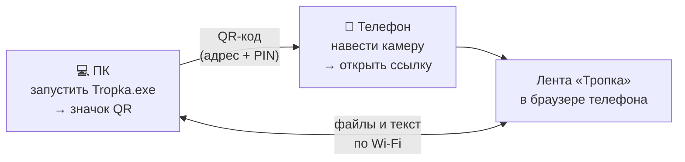
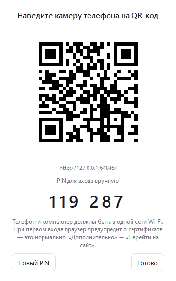
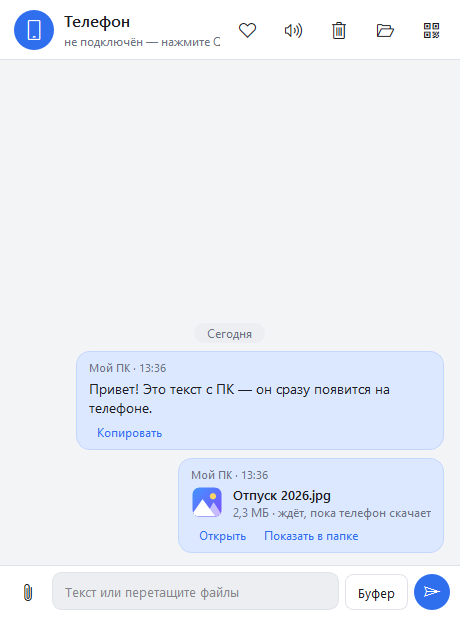

# Тропка

[](https://github.com/OlegChe77/tropka/releases/latest)
[](https://github.com/OlegChe77/tropka/releases)


[](https://dalink.to/olegche)

Файлы и текст между **компьютером с Windows и телефоном** по домашней Wi-Fi сети. На телефон ничего ставить не нужно — он открывает страницу в обычном браузере, отсканировав QR-код.

- Фото и видео с телефона — сразу в папку «Загрузки\Tropka» на ПК, без кабеля и без пережатия.
- Файлы с ПК — на телефон: перетащите в окно или нажмите скрепку.
- Текст и ссылки — в обе стороны, кнопка «Буфер» отправляет то, что скопировано на ПК.
- Работает с Android и iPhone, можно подключить несколько телефонов сразу — у всех общая лента.
- Всё идёт внутри вашей сети: ни облака, ни регистрации, ни интернета не нужно.

⬇️ **[Скачать Tropka.exe](https://github.com/OlegChe77/tropka/releases/latest/download/Tropka.exe)** (Windows 10/11, ~41 МБ, установка не нужна) · [все версии](https://github.com/OlegChe77/tropka/releases)

> Нужно передать файл **с телефона на телефон**? Для этого есть **[Тропка Онлайн](https://olegche77.github.io/tropka-online/)** — работает прямо в браузере, без программы на ПК.

## Как пользоваться



1. Запустите **Tropka.exe** на ПК. Компьютер и телефон должны быть в **одной** Wi-Fi сети.
2. Если «Тропка» спросит «Разрешить доступ телефону?» — нажмите **Разрешить** и **Да** в окне Windows. Программа сама добавит правило брандмауэра и сделает сеть частной.
3. Нажмите значок **QR** справа вверху окна.

   

4. На телефоне наведите камеру на QR и откройте ссылку. Браузер один раз предупредит о сертификате — это нормально, сертификат сделал сам ПК:
   - **Android (Chrome):** «Дополнительные» → «Перейти на сайт 192.168.… (небезопасно)».
   - **iPhone (Safari):** «Показать подробности» → «посетить этот веб-сайт» → «Посетить веб-сайт».
5. Откроется лента. Отправляйте файлы и текст с любой стороны. Если страница попросит PIN — он крупно написан в окне QR на ПК.



Закрытие окна крестиком прячет «Тропку» в трей (значок у часов): там «Открыть», «Показать QR», «Помощь проекту» и «Выход».

## Как это работает (простыми словами)

- ПК запускает маленький веб-сайт прямо у себя (HTTPS, порт 47321). Телефон открывает его в браузере по адресу из QR, например `https://192.168.1.5:47321`.
- Файлы идут **напрямую** по вашей Wi-Fi сети: с телефона в «Загрузки\Tropka» на ПК, с ПК — в «Загрузки» телефона. Через интернет и чужие серверы ничего не проходит.
- Соединение зашифровано (HTTPS). Сертификат «Тропка» создаёт сама при первом запуске, поэтому браузер и предупреждает о нём один раз.
- Чужой в той же сети без QR не войдёт: в QR зашит PIN, после входа телефон запоминается. 5 неверных PIN подряд — адрес блокируется на минуту. Кнопка «Новый PIN» в окне QR выдаёт другой.

## Возможные проблемы и ограничения

- **Только одна сеть.** ПК и телефон должны быть в одной Wi-Fi сети (не гостевой). Через мобильный интернет — нет; для этого есть [Тропка Онлайн](https://olegche77.github.io/tropka-online/) (телефон↔телефон).
- **Предупреждение о сертификате.** Появляется при первом входе и снова — если у ПК сменился IP-адрес. Chrome помнит исключение примерно неделю.
- **«Windows защитил ваш компьютер».** Программа не подписана цифровой подписью: «Подробнее» → «Выполнить в любом случае».
- **Антивирус может удалить exe** (так бывает с программами, собранными PyInstaller). Добавьте папку с Tropka.exe в исключения.
- **Нужен включённый экран телефона.** Если заблокировать телефон или надолго свернуть браузер, передача оборвётся. Страница держит экран включённым, пока открыта.
- **Нет уведомлений на телефоне.** Новые файлы видно, только когда страница открыта.
- **Перенесли exe в другую папку** — Windows снова спросит про брандмауэр.

## Если телефон не открывает страницу

1. Проверьте, что ПК и телефон в **одной** сети (на телефоне включён Wi-Fi, а не только мобильный интернет).
2. Сеть на ПК должна быть **частной**: Параметры → Сеть и Интернет → Wi-Fi (или Ethernet) → ваша сеть → «Частная». «Тропка» умеет сделать это сама — кнопка **«Разрешить доступ телефону»** в окне QR.
3. Если в окне QR красное предупреждение — нажмите ту же кнопку и подтвердите запрос Windows.
4. Страница открылась, но висит или «Нет связи» — нажмите на телефоне «Переподключить».

Подробная пошаговая проверка — в [PHONE_TEST.md](PHONE_TEST.md).

## Ссылки

- Репозиторий: https://github.com/OlegChe77/tropka
- Соседний проект **Тропка Онлайн** (телефон↔телефон в браузере): https://olegche77.github.io/tropka-online/
- ❤️ **Помощь проекту:** https://dalink.to/olegche

## ❤️ Помощь проекту

«Тропка» бесплатная, без рекламы и без сбора данных. Если она вам пригодилась, поддержите автора: **[dalink.to/olegche](https://dalink.to/olegche)**. Это помогает выпускать новые версии.

## Для разработчиков

Python 3.12, aiohttp (сервер), cryptography (сертификат), qrcode, PySide6 (окно), pystray (трей), SQLite, PyInstaller.

```
most/              ← программа (пакет называется most — историческое имя)
  __main__.py      запуск: окно, --console, --hidden
  service.py       сервер в отдельном потоке
  server.py        HTTP API, PIN, сессии, раздача файлов, SSE
  store.py         SQLite: телефоны, лента, доставка
  certs.py         самоподписанный сертификат
  firewall.py      проверка и правило брандмауэра Windows
  gui/             окно (PySide6), лента, тема, трей
  web/             страница телефона (HTML/JS/CSS без внешних библиотек)
  sounds/          звуки ПК
packaging/         спецификация PyInstaller, значок, свойства exe
tests/             тесты (unittest)
build.ps1          сборка dist\Tropka.exe
```

### Запуск из исходников

```bash
pip install -r requirements.txt
```

```bash
python -m most
```

Другие режимы: `python -m most --console` (без окна, QR в терминале), `python -m most --host 127.0.0.1 --no-tls --port 8080` (отладка без HTTPS и брандмауэра).

### Тесты и сборка

```bash
python -m unittest discover tests
```

```bash
powershell -ExecutionPolicy Bypass -File build.ps1
```

Получится `dist\Tropka.exe` (~41 МБ, один файл).
